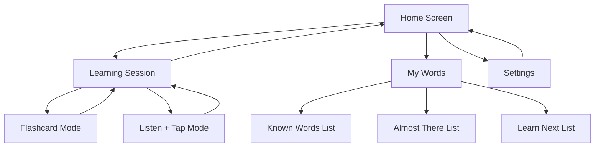

# Chinese Words I Know — Design

**App title:** Chinese Words I Know

This document is the design. The [Requirements](requirements.md) say what to build, and [Tasks](tasks.md) say in what order.

---

## Sub-Specifications

Detailed specs live in the folders below. This document holds the core entities, screen map, folder structure, and tech stack.

### Core logic

| Spec | Covers |
|---|---|
| [Confidence Model](core/confidence-model.md) | Score ranges, state labels, update rules |
| [Learn Next Algorithm](core/learn-next-algorithm.md) | Frequency tiers, scoring function, HSK and SUBTLEX-CH rationale |
| [Content Versioning](core/content-versioning.md) | `contentVersion` field and migration rules |

### UX

| Spec | Covers |
|---|---|
| [Accessibility](ux/accessibility.md) | Touch targets, contrast, font sizes, motion |
| [Progressive Disclosure](ux/progressive-disclosure.md) | `UserSettings` flags and settings panel behavior |
| [First-Run Experience](ux/first-run.md) | Home screen, Start Now, returning-user behavior |
| [Error Handling](ux/error-handling.md) | Error categories and how each is shown |

### Content

| Spec | Covers |
|---|---|
| [Audio](content/audio.md) | Format, naming, `AudioService`, native speaker recording guide |
| [Images](content/images.md) | Format, naming, `ImageService`, style and sourcing |
| [Word Lists](content/word-lists.md) | Recording and illustration checklists for every word |
| [Asset Hosting](content/asset-hosting.md) | GitHub Pages now, S3 + CloudFront later |

### Cloud

| Spec | Covers |
|---|---|
| [Cloud Sync](cloud/sync.md) | Local-first sync strategy, conflict resolution, `SyncService` |
| [Cloud Infrastructure](cloud/infrastructure.md) | AWS architecture, DynamoDB, API, Cognito, CDK stacks |
| [CI/CD](cloud/ci-cd.md) | GitHub Actions pipeline, secrets, failure behavior |

### Platforms

| Spec | Covers |
|---|---|
| [Web](platforms/web.md) | Angular build, GitHub Pages, web asset paths, localStorage |
| [iOS](platforms/ios.md) | Capacitor setup, asset scheme, App Store notes (future) |
| [Android](platforms/android.md) | Capacitor setup, asset scheme, Play Store notes (future) |

### Requirements and plan

| Spec | Covers |
|---|---|
| [Requirements](requirements.md) | Problem statement and product requirements |
| [Tasks](tasks.md) | Implementation plan as a checklist of tasks and subtasks, each traced to a numbered requirement |

### Roadmap

| Spec | Covers |
|---|---|
| [Future Features](roadmap/future-features.md) | Deferred items |

## Specs Included in Context

A Markdown link does not load the linked file. The sub-specs below are included with Kiro file references (paths are from the workspace root), so their content is available whenever a task runs from this spec. The tables above still describe what each one covers.

Not included, because no current task depends on them: [Word Lists](content/word-lists.md), [iOS](platforms/ios.md), [Android](platforms/android.md), and [Future Features](roadmap/future-features.md).

#[[file:.kiro/specs/chinese-words-i-know/core/confidence-model.md]]

#[[file:.kiro/specs/chinese-words-i-know/core/learn-next-algorithm.md]]

#[[file:.kiro/specs/chinese-words-i-know/core/content-versioning.md]]

#[[file:.kiro/specs/chinese-words-i-know/ux/accessibility.md]]

#[[file:.kiro/specs/chinese-words-i-know/ux/progressive-disclosure.md]]

#[[file:.kiro/specs/chinese-words-i-know/ux/first-run.md]]

#[[file:.kiro/specs/chinese-words-i-know/ux/error-handling.md]]

#[[file:.kiro/specs/chinese-words-i-know/content/audio.md]]

#[[file:.kiro/specs/chinese-words-i-know/content/images.md]]

#[[file:.kiro/specs/chinese-words-i-know/content/asset-hosting.md]]

#[[file:.kiro/specs/chinese-words-i-know/cloud/sync.md]]

#[[file:.kiro/specs/chinese-words-i-know/cloud/infrastructure.md]]

#[[file:.kiro/specs/chinese-words-i-know/cloud/ci-cd.md]]

#[[file:.kiro/specs/chinese-words-i-know/platforms/web.md]]

---

## Entity Model

```ts
Word
  id: string                  // the word's slug; permanent once published (see Audio > Slug Rules)
  simplified: string          // 你好
  pinyin: string              // nǐ hǎo
  english: string             // hello
  category: CategoryId
  imageAsset: string | null   // slug for image file, null if not yet received
  audioAsset: string | null   // slug for audio file, null if not yet recorded
  tags: string[]              // e.g. ["greetings", "family"]
  frequencyTier: 1 | 2 | 3 | 4 // conversational priority; 1 = highest; assigned by the rule in Learn Next Algorithm

Category
  id: string
  name: string                // "Animals"
  emoji: string               // 🐾
  coverImage: string

UserWordState                      // keyed by Word.id (wordId)
  wordId: string
  confidenceScore: number          // 0.0 – 1.0, rounded to 2 decimals
  timesSeenCount: number           // answered prompts where this word was the target
  lastSeenAt: string               // ISO 8601 — when the word was last practiced
  manualOverride: "known" | "unknown" | null
  updatedAt: string                // ISO 8601 — when this record was last written; used for cloud conflict resolution
  syncStatus: "synced" | "pending" // local only — never persisted to DynamoDB

UserSettings                       // stored locally at all times, independent of sign-in; not synced in this version
  showPinyin: boolean         // default false — shows pinyin romanization under each word
  showCharacters: boolean     // default false — shows simplified Chinese characters
  audioEnabled: boolean       // default true — plays pre-recorded audio on card reveal and listen + tap mode
  cloudSyncEnabled: boolean   // default false — enables Cognito sign-in and DynamoDB sync
  // Additional boolean flags are added here as new features are introduced

UserProfile                        // exists only once the user has signed in
  id: string                  // Cognito sub
```

---

## Screen Map



---

## Folder Structure

```
chinese-words-i-know/
├── .kiro/
│   └── specs/
│       └── chinese-words-i-know/
│           ├── requirements.md       # Problem statement and requirements
│           ├── design.md             # This document (design entry point)
│           ├── tasks.md              # Implementation plan
│           ├── core/                 # confidence-model, learn-next-algorithm, content-versioning
│           ├── ux/                   # accessibility, progressive-disclosure, first-run, error-handling
│           ├── content/              # audio, images, word-lists, asset-hosting
│           ├── cloud/                # sync, infrastructure, ci-cd
│           ├── platforms/            # web, ios, android
│           └── roadmap/              # future-features
├── assets/                           # Source assets, shared across all platforms
│   ├── audio/
│   │   └── words/                    # One folder per word, named by word ID slug
│   │       ├── mao/
│   │       │   ├── mao-natural.mp3   # Natural speed pronunciation
│   │       │   └── mao-slow.mp3      # Slow/clear pronunciation
│   │       └── ...                   # ~1000 word folders, ~2000 files total
│   └── images/
│       ├── words/                    # One image per word, named by word ID slug
│       │   ├── mao.png
│       │   └── ...
│       └── categories/               # One cover image per category
├── infra/                            # AWS CDK infrastructure (TypeScript)
│   ├── bin/
│   │   └── app.ts
│   ├── lib/
│   │   ├── stateful-stack.ts         # DynamoDB + Cognito
│   │   └── api-stack.ts              # Lambda + API Gateway
│   ├── lambda/
│   │   ├── get-progress/
│   │   │   └── index.ts
│   │   └── put-progress/
│   │       └── index.ts
│   ├── cdk.json
│   ├── tsconfig.json
│   └── package.json
├── src/
│   ├── shared/                       # Platform-agnostic logic
│   │   ├── entities/                 # Word, Category, UserWordState, UserSettings, UserProfile types
│   │   ├── confidence/               # Confidence scoring engine
│   │   ├── content/                  # Word/category data (JSON)
│   │   ├── sync/                     # SyncService, device-agnostic cloud sync
│   │   └── store/                    # State management
│   ├── web/                          # Web app target (Angular)
│   │   ├── app/
│   │   │   ├── components/
│   │   │   └── screens/
│   │   ├── environments/             # environment.ts (dev); environment.generated.ts (written by CI)
│   │   └── main.ts
│   ├── ios/                          # Future iOS target (Capacitor)
│   │   └── README.md
│   └── android/                      # Future Android target (Capacitor)
│       └── README.md
├── tests/
│   ├── shared/
│   └── web/
├── .github/
│   └── workflows/
│       └── deploy.yml                # CI/CD pipeline
└── package.json
```

---

## Tech Stack

| Concern | Choice | Notes |
|---|---|---|
| Build tool | Angular CLI (esbuild application builder) | Default builder; fast builds, static output |
| Language | TypeScript | Type-safe entities and confidence engine |
| UI framework | Angular 22 (standalone components) | Current release as of Nov 2026, supported to Jun 2028. Angular 18 is out of security support |
| Animation / gestures | Angular Animations + HammerJS | Angular Animations for transitions; HammerJS for long-press and swipe gestures |
| Styling | Tailwind CSS v4 | Utility-first; CSS-first config (no `tailwind.config.js`); set up through the Angular CLI's Tailwind support |
| State + persistence | NgRx SignalStore + localStorage | Angular-native signals-based store; localStorage persistence via custom plugin |
| Routing | Angular Router with hash location | `withHashLocation()` avoids 404s on refresh because GitHub Pages has no rewrites. Routes: `/`, `/session/flashcard/:categoryId`, `/session/listen`, `/my-words`. Settings is an overlay with no route |
| Testing | Vitest + Angular Testing Library | Vitest is the Angular CLI's default runner, so no extra plugin is needed |
| Audio | `HTMLAudioElement` (native) | No dependency needed for pre-recorded file playback; works in Capacitor WebViews |
| Offline | Angular service worker (PWA) | Precaches the app shell; caches images and audio on first use |
| iOS / Android bridge | Capacitor (future) | Wraps the Angular web output as a native shell; `src/shared/` logic stays identical |
| Cloud auth | Amazon Cognito User Pools | Email sign-in; JWT attached to every API request; optional — app works offline without it |
| Cloud database | Amazon DynamoDB | Single table; `userId` PK + `wordId` SK; pay-per-request billing |
| Cloud API | API Gateway HTTP API + Lambda (Node.js 22) | `GET /progress` and `PUT /progress`; JWT authorizer via Cognito |
| Cloud sync client | AWS Amplify Auth (`aws-amplify/auth`) | Token management and refresh; `fetch` for API calls — works on web and Capacitor |
| Infrastructure as code | AWS CDK (TypeScript) | Two stacks: stateful (DynamoDB + Cognito) and API (Lambda + API Gateway) |
| Deployment | Static output (`ng build`) + `cdk deploy` | App → GitHub Pages via GitHub Actions; infra → AWS via CDK; CI authenticates to AWS with OIDC |
